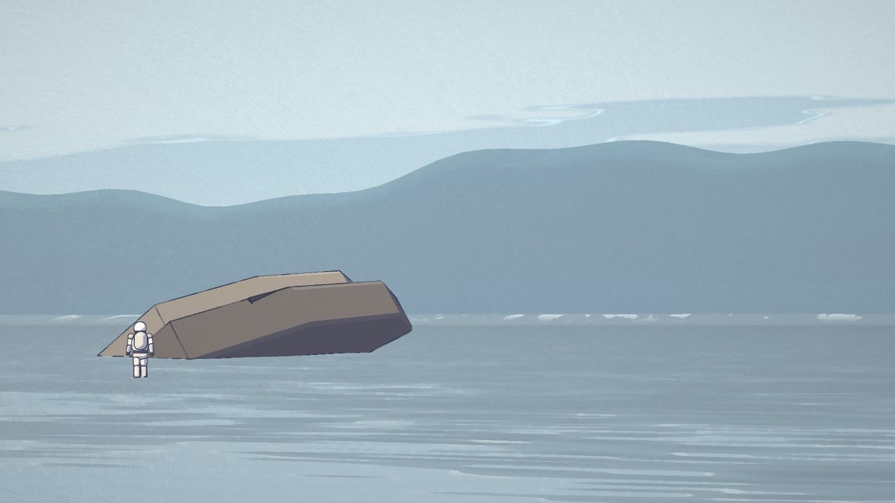
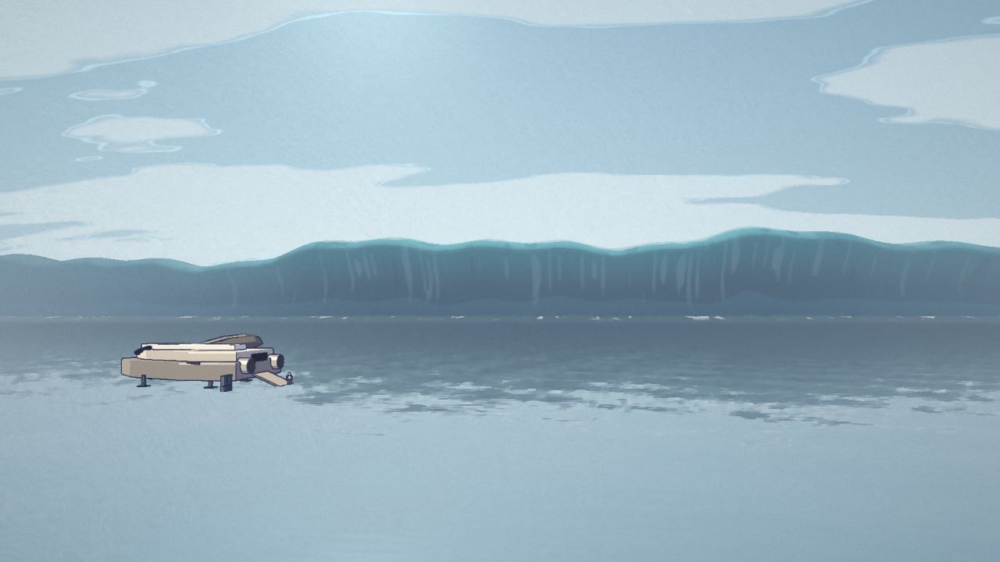

# 米勒星球 · Miller's Planet in JavaScript

A 54-second fan remake of the tidal-wave scene from *Interstellar* (2014), drawn entirely in code. Every frame is rendered live in the browser with three.js, and the soundtrack is synthesized with Web Audio. There are no video files, image files, or audio files.

**Watch:** https://henrymeihao.github.io/miller-planet-js/

| | | |
|---|---|---|
|  |  |  |
|  |  |  |

> Unofficial fan tribute. Not affiliated with or endorsed by Paramount, Warner Bros. or Legendary. The music is original, not the film's score. The shot order follows the original scene; the models, look and sound are made from scratch.

## How it works

- **Every frame is a pure function of time.** `src/00-util.js` holds the story beats (`CUES`) and the 24 shots (`SHOTS`). Each shot has a camera function in `src/61-cams.js`; where the astronauts, CASE, the Ranger and the wave are at time *t* lives in `src/60-shots.js`. Any frame can be rendered on its own, in any order.
- **3D underneath, a drawing on top.** The main pass writes colour plus a data buffer (normal, depth, material id). A Kuwahara filter paints the background like gouache, an ink pass outlines the cel-shaded characters, and a final pass adds bloom, grade and grain.
- **The wave is one moving profile.** `src/20-world.js` sweeps a 2D cross-section along a 10 km line and redraws it on twos (12 drawings a second). Far away and hazed, it reads as a mountain range. The Ranger's height and tilt on the face come from the same profile, so it is carried up and over the crest.
- **Sound is synthesized when the page loads.** `src/70-audio.js` renders the clock tick (one every 1.25 s), wading, CASE's slabs hitting the water, the wave's rumble, the engines and an original organ progression into one buffer.

## Build

Needs Node 18+. No dependencies to install.

~~~bash
node build.mjs          # writes index.html, a single self-contained page
python3 -m http.server  # then open http://localhost:8000
~~~

URL parameters: `?t=44.8` jumps to a time, `?q=low` renders at 1280×720, `?headless=1` hides the player bar, `?cam=x,y,z&at=x,y,z&fov=30` overrides the camera for review.

## Layout

~~~
src/00-util.js     timing, CUES, SHOTS, helpers
src/10-post.js     paint / ink / bloom / grade passes
src/20-world.js    sky, sea, the wave and its profile
src/40-ranger.js   the Ranger and its cockpit
src/42-props.js    the wreck, CASE
src/45-astro.js    astronauts
src/50-spray.js    spray and wake
src/60-shots.js    the performance
src/61-cams.js     the cameras
src/70-audio.js    the soundtrack
src/80-main.js     frame loop, title card, player
glsl/              shaders (#include inc_*.glsl)
vendor/            three.js r170
~~~

## Credits

The engine follows the approach of [0xCodez/leviathan](https://github.com/0xCodez/leviathan) (MIT). The paint and ink shaders in `glsl/paint_fs.glsl` and `glsl/ink_fs.glsl` are adapted from it. three.js is MIT, see `vendor/THREE-LICENSE`.
